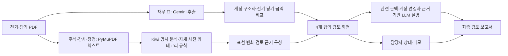
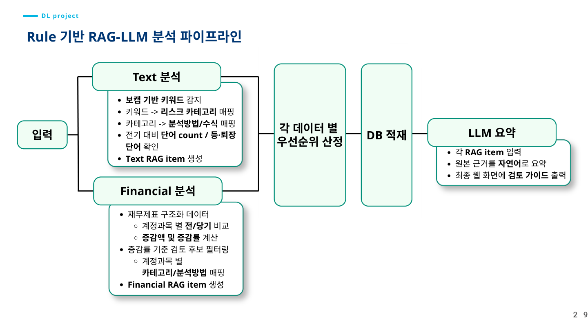
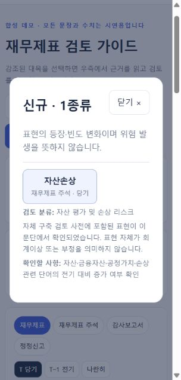

# 재무제표 검토 가이드

**전기·당기 보고서를 비교해 검토할 표현과 금액 변화를 찾고, 원문 근거·관련 주석·담당자 기록을 한 화면에 연결하는 은행 RM 업무 보조 웹입니다.**

> 사전과 규칙이 확인할 위치를 찾고, LLM이 근거를 쉽게 설명하며, 최종 판단은 담당자가 합니다. 회계부정 판정·신용평가·여신 승인 자동화 모델은 아닙니다.

| 항목 | 내용 |
|---|---|
| 팀 프로젝트 | **표독하조 · 6인 팀 프로젝트** |
| 문제 정의 | RM이 분산된 주석·감사보고서를 읽고 전기·당기 변화를 비교하는 반복 검토를 어떻게 줄일 것인가? |
| 데이터 | **DART·KIND에서 수집한 사업보고서·감사보고서**의 재무제표·주석·감사의견 등. 동일 기업의 전기·당기 PDF를 입력해 비교 |
| 사전 구축 | K-IFRS·회계감사기준을 참고한 표현 정제 → 의미별 핵심 키워드 그룹화 → **7개 위험 카테고리** 구성 |
| 기존 분석·구현 | Gemini 표 추출·PyMuPDF 텍스트 추출 → Kiwi·자체 사전 매칭 → 전기·당기 표현·계정 비교 → **Text/Financial RAG item → LLM 검토 가이드** |
| 후속 개선 | Gemini API 키 인증 경로·SDK 통합, 선택 항목 중심 근거 연결, 생성 설명 검증, 금액 비교 요약, 처리 상태·로그, 검토 기록·최종 보고서 |
| 개인 역할 | **전체 개요·분석 방향 총괄, 프로젝트 기획, 파이프라인 구축, 정합성 검증, 문서 추출·분석·API·웹 연동 등 기술 전반 활용**  |
| 결과물 | 재무제표·주석·감사보고서·정정신고 **4개 탭**, 변화별 하이라이트, 관련 근거·페이지 후보, 담당자 확인사항·메모, 최종 HTML 보고서 |
| 판단 범위 | 회계이상 확정이나 자동 여신 판단이 아닌 **사전·규칙·근거 기반 RM 검토 지원** |

단어장·사전 구축과 서비스 결과는 팀 작업입니다. 프로젝트 시작·종료일은 확인되지 않아 기재하지 않았습니다. 발표자료의 297개 표기는 기업 수와 기간별 보고서 관측 수가 혼재되어 있어 고유 기업 수로 단정하지 않습니다. 은행 교육용 데이터 결합 구상은 현재 웹의 필수 입력이나 개별 기업 매칭 기능과 구분합니다.

[발표자료 PDF](docs/presentation.pdf) · [기술·설계 상세](docs/ARCHITECTURE.md) · [Gemini 실행 안내](docs/GEMINI-API.md) · [검증 범위](docs/VALIDATION.md) · [웹 포트폴리오 요약](portfolio-summary.md)

## 1. 문제와 설계 방향

재무제표의 숫자만으로는 변동의 배경을 알기 어렵고, 주석에서 특정 단어를 발견했다고 실제 문제가 발생한 것으로 판단할 수도 없습니다. 담당자는 **어느 계정이 얼마나 변했는지, 관련 설명이 어디에 있는지, 무엇을 추가로 확인해야 하는지**를 함께 읽어야 합니다.

따라서 “이상 여부를 AI가 결정하는 서비스”보다 **확인할 대목과 근거를 먼저 좁혀주는 검토 도구**로 설계했습니다. 숫자는 코드로 계산하고, 설명은 출처가 연결된 문맥 안에서 생성하며, 판단과 후속 조치는 담당자 기록으로 남깁니다.

DL 프로젝트라는 명칭은 외부 Gemini 모델을 활용한 문서 이해·표 추출에서 출발했습니다. 이 저장소에서 자체 딥러닝 모델을 학습하거나 파인튜닝한 것은 아닙니다.

## 2. 전체 파이프라인



| 단계 | 실제 처리 | 이렇게 나눈 이유 |
|---|---|---|
| 입력·영역 구분 | 전기·당기 PDF를 작업별로 보관하고 목차·구간을 탐색 | 다른 기업·기간·작업의 결과가 섞이는 것을 줄이기 위해 |
| 문서 추출 | Gemini가 재무 표를 추출하고 PyMuPDF가 검색 가능한 문서 텍스트를 읽음 | 표의 행·열과 긴 주석 문장은 처리 특성이 다르기 때문 |
| 텍스트 분석 | Kiwi 명사 분석, N-gram 후보 탐색, 자체 사전과 카테고리 매핑 | 일반 단어보다 검토 목적에 맞는 회계 표현에 집중하기 위해 |
| 기간 비교 | 표현의 신규·소멸·증가·감소·유지와 계정 금액 비교 | 전체 보고서를 다시 읽기 전 변화한 부분을 좁히기 위해 |
| 근거 연결 | 규칙·키워드로 관련 문단·페이지 후보·재무 계정을 조회 | 단어 한 개를 문맥 없이 해석하지 않도록 |
| 설명·결정 | 텍스트는 근거 제한 LLM 설명, 금액은 코드 계산 요약, 판단은 담당자 | 계산·설명·의사결정을 분리하기 위해 |

발표 당시의 전체 구상은 아래와 같습니다. **그림의 DB 적재·은행 데이터 연계 구상과 현재의 로컬 JSON 저장 구현은 구분**합니다.



## 3. 분석은 웹과 어떻게 연결되는가?

### 표현 변화: 문서에서 다시 읽을 대목을 찾기

재무제표는 전기·당기 금액을 같은 표에서 비교할 수 있지만, **감사보고서와 재무제표 주석은 여러 문단과 페이지에 설명이 분산되어 있어 기간별 변화와 연관 내용을 한눈에 파악하기 어렵습니다.** 팀은 이 비정형 설명에서도 기업별 검토 포인트를 찾을 수 있다고 보았고, 담당자가 다시 읽을 위치를 좁혀주기 위해 회계·감사 도메인 사전을 직접 구축했습니다.

발표자료의 사전 구축 과정(원본 슬라이드 24–27, 첨부 PDF 23–26페이지)은 다음과 같습니다.

1. **추출·청킹:** 보고서에서 텍스트를 추출하고 목차 패턴으로 문단을 나눈 뒤, Kiwi로 명사와 후보 표현을 추출했습니다.
2. **회계 기준 기반 정제:** K-IFRS와 회계감사 보고서·회계감사기준을 참고해 직접 분류하고, 의미 없는 일반 명사·포괄적 용어·오탐지 요소를 수동으로 걸러냈습니다.
3. **의미별 그룹화:** 정제한 표현을 리스크의 의미적 연관성에 따라 핵심 키워드로 묶고, **7가지 핵심 위험 카테고리**로 분류해 전략적 리스크 사전의 뼈대를 구성했습니다.
4. **대조와 검토 연결:** 발표자료에서 정상·회계이상으로 구분한 기업들의 표현을 대조하고, 확인할 키워드를 카테고리별 검토 방법과 연결했습니다. 이 구분은 프로젝트 자료의 분류이며, 현재 웹이 기업을 정상·이상으로 판정한다는 뜻은 아닙니다.

**사전의 목적은 회계이상을 확정하는 것이 아니라, 검토할 가능성이 있는 표현과 변화의 근거를 정리해 담당자에게 제시하는 것입니다.** 키워드가 발견되거나 횟수가 늘었다는 사실만으로 문제가 발생했다고 해석하지 않습니다. 관련 문맥·금액·회계처리 배경을 함께 읽고 추가 확인할 사항을 판단하도록 구성했습니다. 또한 기준을 참고한 팀의 분류 체계이며, 공식 회계 기준이 인증한 위험 탐지 사전이나 성능이 검증된 부정 탐지 모델은 아닙니다.

현재 실행 코드의 사전은 **367개 표현, 7개 카테고리 규칙**으로 구성됩니다. 기존 분석 파이프라인은 Kiwi로 명사·후보 표현을 추출해 카테고리를 연결하고, 기간별 변화와 검토 우선순위를 구성합니다.

웹의 표현 횟수는 별도로 **화면에 포함된 추출 문단에서 사전 문자열이 겹치지 않게 일치한 횟수**를 계산합니다. 같은 시작 위치에서는 긴 표현을 우선합니다. 기존 명사 데이터의 행 수와 동일한 지표가 아닙니다.

| 화면의 변화 | 조건 | 해석 범위 |
|---|---|---|
| 신규 | 전기 0회, 당기 1회 이상 | 추출 문단에서 새로 확인됨 |
| 소멸 | 전기 1회 이상, 당기 0회 | 당기 추출 범위에서 확인되지 않음 |
| 증가·감소·유지 | 두 기간의 일치 횟수 비교 | 표현 빈도의 변화이며 위험 크기의 변화는 아님 |

기존 코드의 우선순위는 생성 여부 + 소멸 여부 + 횟수 변화량의 절댓값을 이용한 규칙 점수입니다. 학습된 부정 발생 확률이나 검증된 위험 점수로 해석하지 않습니다.

### 재무 비교: 금액과 검토 질문을 분리하기

같은 업로드 보고서에 **명시된 전기·당기 금액 열**을 비교합니다. OCR의 열 순서는 유지하고, 해당 하이라이트가 어느 계정인지 함께 표시합니다.

```text
증감액 = 당기 − 전기
증감률(%) = (당기 − 전기) / |전기| × 100
```

전기가 0이면 증감률을 계산하지 않습니다. 음수 전기 값에는 절댓값 분모를 썼다는 점을 안내합니다. PDF의 재무 표 추출 구간에서 원·천원·백만원 단위를 확인하고, 확인된 경우에만 화면에서 원 단위로 환산해 쉼표와 `원`을 표시합니다.

추가 웹 규칙은 절대 증감률 50% 이상, 0에서 금액 발생, 부호 전환, 총자산 대비 절대 금액 비중 50% 이상 등을 검토 후보로 표시합니다. 총자산 대비 0.1% 이하 소액이면서 증감률이 큰 경우에는 기저효과 확인을 제안합니다. **프로젝트에서 성능을 검증한 임계값이 아니라 후속 웹 개선에 추가한 탐색 기준**입니다.

재무제표 요약은 LLM이 재계산하지 않고 코드의 비교 결과를 사용합니다. 예를 들어 매출채권에는 회수·대손 관련 주석, 차입금에는 만기·이자·상환 관련 내용을 확인하도록 질문을 연결합니다. 이는 문제를 발견했다는 결론이 아닙니다.

### 근거 기반 설명: 요약에서 실제 확인으로 이어지기

주석·감사·정정 문서의 LLM 설명은 **선택 문단의 한 문장 요약 → 다른 문맥·재무 계정 연결 후보 → RM 확인 관점** 순서로 요청합니다. 선택 표현의 앞뒤 문맥과 관련 후보만 전달하며, 모르는 정의나 원인을 생성하도록 허용하지 않습니다.

응답은 다음 조건을 통과해야 표시·저장됩니다.

- 출처 ID가 제공된 근거에 실제로 존재할 것
- 인용문이 해당 출처에 연속된 문자열로 존재할 것
- 설명의 숫자가 인용한 출처에서 확인될 것
- 응답 구조와 길이가 로컬 스키마에 맞을 것

출처 목록은 검증 대상 인용문에서 구성해 출처 목록과 인용문의 불일치를 줄였습니다. 이 검사는 **설명의 의미가 정확하다는 보증은 아니므로** 담당자가 원문과 대조해야 합니다. 일부 용어의 일반 개념은 별도 출처 사전으로 제공하고 해당 기업의 실제 발생 사실과 구분합니다.

발표 당시에는 텍스트·재무 분석을 각각 `Text RAG item`과 `Financial RAG item`으로 구조화한 뒤 LLM에 전달했습니다. 현재도 **분석 결과 → 관련 근거 구성 → LLM 설명**이라는 흐름을 유지하지만, 이전 JSON 항목을 그대로 모두 읽어 설명하는 구현과는 차이가 있습니다. 웹의 텍스트 검토 항목은 추출 문단에서 사전·규칙으로 다시 구성하고, 선택한 항목의 원문·기간별 횟수·관련 문단·관련 계정 후보를 `evidence_pack`으로 묶어 LLM에 제공합니다. 기존 재무 하이라이트는 `financial_rag_items`의 근거를 연결하며, 전기·당기 금액 비교 요약은 코드 계산을 우선합니다.

이 프로젝트의 RAG는 벡터 DB 검색이 아니라 **사전·규칙·키워드로 관련 근거를 구성해 LLM에 전달하는 방식**입니다. 동일 키워드가 존재한다는 이유만으로 동일 거래나 인과관계로 연결하지 않습니다.

## 4. 담당자가 사용하는 화면

| 기능 | 사용 흐름 |
|---|---|
| 문서 네 탭 | 재무제표 / 재무제표 주석 / 감사보고서 / 정정신고 |
| 하이라이트 | 계정·표현 클릭 → 표시 이유·비교값·원문 근거 확인 |
| 요약 카드 | 신규·소멸 등 클릭 → 종류별 목록을 작은 창에서 확인 |
| 담당자 확인사항 | 질문 클릭 → 표현 변화·관련 문맥·재무 계정을 모아 확인 |
| 원문 페이지 | PDF 텍스트가 일치한 업로드 페이지 후보 표시 |
| 내 검토 기록 | 미검토 / 확인 완료 / 추가 확인 필요로 분류하고 메모 저장·필터 |
| 최종 보고서 | 근거·상태·메모·생성 설명을 HTML로 저장하거나 인쇄해 PDF 보관 |

은행 거래 데이터가 필요한 확인사항은 **추가 자료 필요**로 표시합니다. 확인사항을 클릭해 읽는 것과 실제 확인 완료 처리는 구분합니다.



## 5. 기술 스택과 선택 이유

| 영역 | 기술 | 사용 이유와 범위 |
|---|---|---|
| 분석·처리 | Python, pandas, NumPy | 표 데이터 정리, 수치 변환, 기간 비교와 파이프라인 연결 |
| 표 추출·설명 | Gemini API, Google Gen AI SDK | 복잡한 재무 표의 추출과 근거를 제한한 자연어 설명. 자체 모델 학습은 없음 |
| PDF | PyMuPDF | 목차·페이지·텍스트 추출, 페이지 후보 탐색 |
| 한국어 텍스트 | Kiwi | 명사·후보 표현 추출과 도메인 사전 연결 |
| API | FastAPI, Uvicorn, python-multipart | PDF 업로드, 작업 상태, 검토 기록·설명·보고서 API |
| 정합성 | Pydantic, Decimal, unittest | 구조·출처·숫자 검증, 금액 계산, 합성 입력 기반 회귀 검증 |
| 웹 | HTML, CSS, JavaScript | 문서 탭, 클릭 근거, 필터·모달·검토 기록을 직접 연결 |
| 저장·내보내기 | JSON, CSV, openpyxl, HTML | 작업별 로컬 결과·메모 저장, 중간 표와 최종 보고서 내보내기 |
| 실행 분리 | subprocess, ThreadPoolExecutor | 작업을 순차 처리하고 별도 프로세스에서 파이프라인 실행 |

버전은 로컬 환경에서 확인한 값을 `requirements*.txt`에 기록했습니다. 기존 Vertex AI 관련 코드도 작업 이력으로 포함하지만, 현재 권장 실행은 **Gemini API 키 방식**입니다. SQL DB·벡터 DB·딥러닝 학습 프레임워크를 현재 서비스의 사용 기술로 기재하지 않습니다.

### 기존 구현에서 무엇을 개선했는가?

| 영역 | 기존 | 현재 | 개선 목적 |
|---|---|---|---|
| OCR API | Vertex AI `GenerativeModel` | `google-genai` 클라이언트, Gemini API 키/Vertex 공급자 선택 | 인증 경로 선택과 SDK 통합 |
| RAG | Text/Financial RAG item → 기존 요약 모듈 | 선택한 표현·원문·관련 문맥·계정 후보 → `evidence_pack` | RM이 보는 항목을 중심으로 근거 연결 |
| 설명 API | 기존에도 `google-genai` 사용, 분석 흐름에 요약 단계 연결 | 별도 설명 API, JSON 스키마·Pydantic·출처·인용·숫자 검사 | 생성 실패를 규칙 결과와 분리하고 근거 추적 강화 |
| 금액 설명 | 재무 근거와 LLM 요약 | 전기·당기 금액·증감률을 코드로 계산·서술 | 산술의 재현성과 단위 확인 |
| 웹·실행 | FastAPI·Jinja2·기존 분석 함수 연결 | FastAPI·JavaScript, 작업별 Worker·진행 상태·로그 | 분석 진행 확인과 검토 UX 개선 |
| 검토 결과 | viewer·분석 결과 | 관련 근거 탐색·검토 기록·최종 HTML 보고서 | 발견에서 담당자의 확인까지 연결 |

**FastAPI와 RAG 개념을 새로 도입한 것이 아니라, 기존 분석 자산을 유지하면서 API 인증·근거 구성·응답 검증·검토 흐름을 개선했습니다.** 기존/현재 모듈, 인증 환경변수, 외부 전송 범위, RAG item 연결, API 경로, 캐시·타임아웃·한계는 [기술 스택 변화와 RAG·API 연동 상세](docs/TECHNICAL-EVOLUTION.md)에 정리했습니다.

## 6. 기여와 프로젝트 범위

개인 기여는 사용자 확인에 따라 **프로젝트 전체 개요와 분석 방향 총괄, 문제 정의·기획, 파이프라인 구축, 정합성 검증, 기술 스택 전반 활용**으로 기재했습니다. 공식 PM 직책을 맡았다는 의미는 아닙니다. 단어장·사전 구축과 서비스 결과는 팀 작업임을 함께 명시합니다.

발표 당시에는 문서 추출·자체 사전·규칙 분석·전기 당기 비교·근거 기반 웹의 흐름을 구성했습니다. 후속 정리에서는 작업 격리, SDK·인증 연결, 계산 요약, 출처 검증, 근거 탐색, 기록·보고서 UI를 개선했습니다. 원본 코드와 자료를 수정하지 않고 복사본에서 정리했습니다.

## 7. 실행과 저장소 구성

Python **3.12.14** 로컬 환경에서 확인했습니다. 설치된 Python 버전이 다르면 의존성 호환성을 별도로 확인하세요.

VS Code의 **파일 → 폴더 열기**로 이 README가 있는 폴더를 열고 **터미널 → 새 터미널**에서 실행합니다.

```powershell
python -m venv .venv
.\.venv\Scripts\python.exe -m pip install -r requirements.txt
.\.venv\Scripts\python.exe -m uvicorn app:app --host 127.0.0.1 --port 8765
```

[로컬 화면](http://127.0.0.1:8765)에서 **합성 데모 열기**를 선택하면 키·실데이터 없이 검토 화면을 확인할 수 있습니다. 실제 PDF 추출과 LLM 설명은 [Gemini 설정 안내](docs/GEMINI-API.md)에 따라 선택 의존성과 본인 키를 설정해야 합니다.

```text
app.py                    API·작업 실행·검토 기록·보고서
web/                      HTML·CSS·JavaScript 검토 화면
review/                   결과 변환·정합성 검증·금액 요약·근거 연결
legacy/                   기존 분석 파이프라인·자체 사전의 복사본
scripts/                  작업 프로세스·합성 Gemini 연결 진단
tests/                    합성 입력 기반 자동 검증
docs/presentation.pdf     팀원 소개를 제외한 발표자료
docs/                     실행·설계·검증·자료 해석 안내
assets/                   파이프라인 그림·합성 데모 화면
portfolio-summary.md      웹사이트용 요약
requirements*.txt         실행·선택 OCR/LLM·테스트 의존성
```

테스트 실행:

```powershell
.\.venv\Scripts\python.exe -m pip install -r requirements-test.txt
.\.venv\Scripts\python.exe -B -m unittest discover -s tests -v
```

## 8. 검증 결과와 한계

- **자동 테스트 26개:** 변화 분류, 문자열 위치, 기록 저장, 보고서, 출처·인용·숫자 검사, 관련 근거 연결, 금액 비교 등. 상세 범위는 [검증 기록](docs/VALIDATION.md)에 구분했습니다.
- **사용자 실행 확인:** 실제 PDF의 분석 결과 화면 출력과 합성 Gemini 설명 생성·검증 성공을 확인했습니다. 마지막 UI·규칙 변경 전체를 새로운 키·새 환경에서 끝까지 다시 실행한 독립 검증은 아닙니다.
- **정량 성과:** 탐지 정확도, 재현율, RM 시간 절감률, 손실 방지 금액은 측정하지 않았습니다.
- **자료 범위:** 발표자료에 기업 수·사전 규모·은행 데이터 결합 구상이 여러 형태로 나옵니다. 현재 코드의 집계와 구분하며 데이터 전수 재현 결과로 제시하지 않습니다.
- **추출 한계:** PyMuPDF의 텍스트 추출은 이미지형 PDF 전체 OCR을 보장하지 않습니다. 누락·오탈자·잘못된 표 대응·단위 혼합을 원문과 대조해야 합니다.
- **해석 한계:** 표현 빈도와 금액 변화는 회계부정의 증거가 아닙니다. 규모가 작은 계정의 높은 증감률, 재분류·회계정책 변경도 확인해야 합니다.
- **페이지 한계:** 일치한 PDF 페이지는 후보이며 인쇄 페이지와 다를 수 있습니다. PDF 원본 위 좌표 하이라이트 기능은 아닙니다.
- **운영 한계:** 개인 PC의 로컬 도구입니다. 다중 사용자 인증, 조직 권한, 운영용 보안·감사 체계는 별도 구축이 필요합니다.

다음 개선은 정답 라벨을 만든 OCR·표 대응 평가, 검토자 간 일치도, 실제 검토 시간 측정, 규칙 임계값 검증 순으로 진행할 수 있습니다.

## 공개 범위

실제 입력 PDF, 은행 원본 데이터, 실행 결과, 고객 식별자, API 키·서비스 계정 인증 파일은 포함하지 않습니다. 발표자료는 사용자 공개 허용 범위에 따라 팀원 소개를 제외한 PDF 복사본을 제공합니다. 발표자료의 기존 예시와 수치는 역사적 자료로 보존하며 최신 앱 검증 결과와 구분합니다.

실행하면 `.local/`에 문서·결과·검토 기록이 저장될 수 있습니다. **이 폴더와 `.venv/`, 키 파일은 업로드하지 마세요.** `.gitignore`는 Git에 적용되며 브라우저 직접 업로드 시 자동으로 제외해주지 않습니다. 자료·사전에 새로운 공개 라이선스를 임의로 부여하지 않았습니다.
